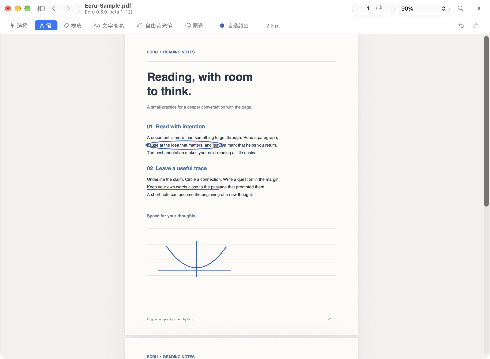
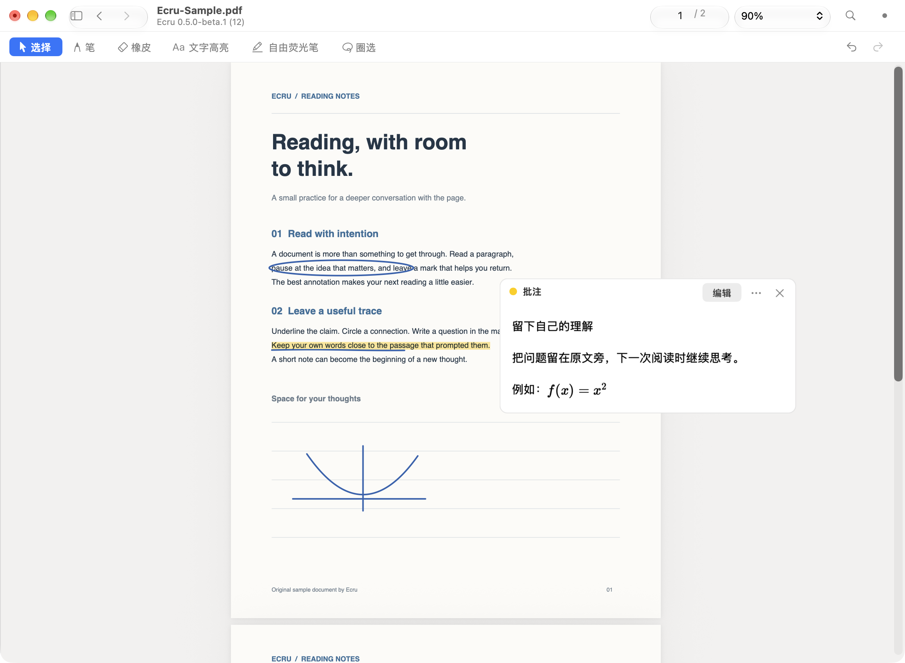

# Ecru

轻量、原生的 macOS PDF 阅读与手写批注工具。打开文档，在原文上直接书写，把想法留在阅读现场。

**首个公开 Beta：0.5.0-beta.1（12）** · Apple Silicon · macOS 13 Ventura 或更新版本

[下载 DMG](https://github.com/double-u-zw/Ecru/releases/download/v0.5.0-beta.1/Ecru-0.5.0-beta.1-arm64.dmg) · [发布说明与校验文件](https://github.com/double-u-zw/Ecru/releases/tag/v0.5.0-beta.1) · [反馈问题](https://github.com/double-u-zw/Ecru/issues/new/choose)



## 主要功能

- Google Ink 手写引擎：直接写在 PDF 页面上，支持颜色和笔宽调整。
- 六种工具：选择、笔、文字高亮、自由荧光笔、橡皮和圈选移动。
- 文本搜索、目录、缩略图、页面导航和多窗口阅读。
- 与原文关联的文字批注，支持离线 Markdown 与数学公式预览。
- 撤销与重做、保存与另存为；批注保存在 PDF 内，重新打开可继续编辑。
- 意外中断后的未保存草稿恢复，以及历史 Ecru 批注兼容。

无需账号。PDF 阅读、手写和文字批注预览均在本机完成，无需联网。



截图来自真实 AppKit 窗口，使用本项目的合成示例 PDF。

## 系统要求

| 项目 | 要求 |
| --- | --- |
| 芯片 | Apple Silicon（M 系列，arm64） |
| 系统 | macOS 13 Ventura 或更新版本 |
| 本次实际验证 | Apple Silicon / macOS 27.0.1 |
| 界面 | 主要为中文；应用名与部分系统菜单支持英文 |

本 Beta 未提供 Intel 安装包。较早的 macOS 与不同输入设备尚未逐一实机验收。

## 下载与安装

1. 从上方链接或 [Releases](https://github.com/double-u-zw/Ecru/releases) 下载 **Ecru-0.5.0-beta.1-arm64.dmg**。GitHub 自动生成的 “Source code” 压缩包仅含这个分发仓库的说明和图片，不能用来安装 App。
2. 打开 DMG，将 **Ecru.app** 拖入 **Applications（应用程序）**，然后推出磁盘映像。
3. 从“应用程序”启动 Ecru。
4. 本 Beta 使用临时签名，**尚未经过 Developer ID 签名或 Apple 公证**。首次打开若被 macOS 拦截，关闭提示，进入 **系统设置 → 隐私与安全性**，在 Ecru 的拦截提示旁点击 **仍要打开 / Open Anyway**，按系统提示确认。此操作仅为 Ecru 添加例外。具体界面见 [Apple 官方说明](https://support.apple.com/zh-cn/102445)。

不要关闭 Gatekeeper 或系统完整性保护。如果设备受组织管理、系统没有提供放行选项，请联系设备管理员。

### 校验下载

从同一 Release 下载 `SHA256SUMS.txt`，与 DMG 放在同一文件夹后运行：

```sh
shasum -a 256 -c SHA256SUMS.txt
```

应显示 DMG 文件名和 `OK`。SHA-256 用于确认下载内容一致，并不代替 Apple 公证。

## 使用方法

1. 启动后选择 PDF，或按 **⌘O** 打开文件；也可在 Finder 中使用“打开方式 → Ecru”。
2. 默认进入笔工具，在页面上直接书写。用工具栏切换选择、高亮、荧光笔、橡皮与圈选；快捷键为 **⌘1** 选择、**⌘2** 笔、**⌘3** 文字高亮、**⌘4** 自由荧光笔、**⌘5** 橡皮、**⌘6** 圈选。
3. 橡皮用于擦除 Ecru 笔迹；圈选后可以拖动选中的 Ecru 笔迹。其他软件产生的批注会尽量保留，不承诺全部可编辑。
4. 使用 **⌘Z** 撤销、**⇧⌘Z** 重做；使用 **⌘F** 搜索 PDF 文本。
5. 选择一段原文，按 **⇧⌘N** 添加文字批注；可使用 Markdown、`$行内公式$` 或 `$$独立公式$$`。
6. 使用 **⌘S** 保存到当前 PDF，**⇧⌘S** 另存为。保存后重新打开同一 PDF 即可继续编辑，无需伴随文件。
7. 如果应用意外退出，重新打开原路径的 PDF 时会提示可恢复草稿。恢复后仍需保存；原文件在外部发生变化时，应另存为新文件。

首次试用可先使用文档副本。正常关闭或退出时，Ecru 会询问是否保存未保存的修改。

## 已知限制

- 目前主要针对普通 PDF；加密 PDF、数字签名、表单、嵌入附件以及部分交互结构会被拒绝打开，以避免不完整地改写文件。
- 没有 OCR。扫描页可以手写，文字选择与搜索需要 PDF 自带文本层。
- 其他 PDF 编辑器修改 Ecru 的私有批注数据后，部分内容可能仅能查看或进入保护状态；建议保留 Ecru 保存的原始版本。
- 尚无自动更新。新版本请从本仓库 Releases 手动安装。
- 中文输入法、不同触控板/数位板、混合 DPI 多显示器与长期多窗口使用仍需更多真人测试。鼠标与系统接收到的指针/压感事件可用于书写，不承诺所有设备驱动的行为。
- 未公证的首次启动需要手动放行；受管理的 Mac 可能禁止运行。

## 问题反馈

通过 [GitHub Issues](https://github.com/double-u-zw/Ecru/issues/new/choose) 提交问题。请附上 Ecru 版本、macOS 版本、芯片、输入设备、复现步骤和预期结果；仅在适合公开分享时附上示例 PDF 或截图。应用内也可通过“帮助 → 反馈问题”进入。

## 分发与第三方声明

这是 Ecru 的公开下载、使用说明和反馈仓库。正式开发源码与历史 Git 仓库保持独立；本仓库不包含应用的开发源码。

[第三方组件与许可证](THIRD_PARTY_NOTICES.md) · [分发说明](DISTRIBUTION.md) · [首次 Beta Release Notes](RELEASE_NOTES.md)

---

**Ecru** is a native PDF reader and handwriting annotation app for macOS. This first public Beta is for **Apple Silicon on macOS 13+**, with a primarily Chinese interface. Download the DMG, drag Ecru to Applications, and launch it. This build is ad-hoc signed and not Apple-notarized: if blocked, use **System Settings → Privacy & Security → Open Anyway**, following [Apple’s instructions](https://support.apple.com/en-us/102445). Intel, OCR, automatic updates, encrypted/signed/form PDFs are not supported in this release. Use [Issues](https://github.com/double-u-zw/Ecru/issues/new/choose) for feedback.
