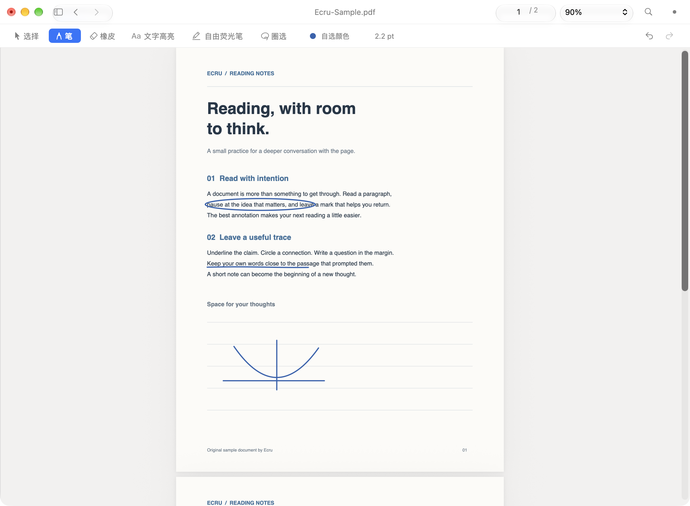
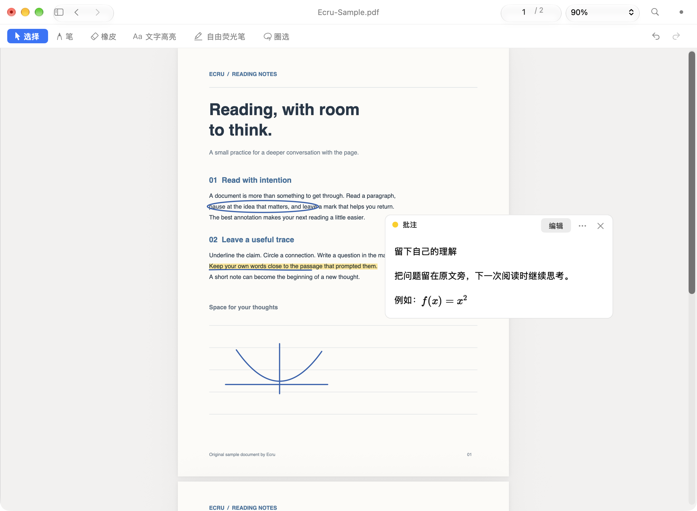

# Ecru

轻量、原生的 macOS PDF 阅读与手写批注工具。打开文档，在原文上直接书写，把想法留在阅读现场。

**Beta：0.5.0-beta.3（19）** · macOS 13+ · Apache-2.0

[Apple Silicon DMG](https://github.com/double-u-zw/Ecru/releases/download/v0.5.0-beta.3/Ecru-0.5.0-beta.3-arm64.dmg) · [Intel DMG](https://github.com/double-u-zw/Ecru/releases/download/v0.5.0-beta.3/Ecru-0.5.0-beta.3-x86_64.dmg) · [发布说明与校验文件](https://github.com/double-u-zw/Ecru/releases/tag/v0.5.0-beta.3) · [反馈问题](https://github.com/double-u-zw/Ecru/issues/new/choose)



## 主要功能

- Google Ink 与真实压感手写、连续笔宽、停笔图形规整与恢复手绘。
- 已有图形的独立边框、填充颜色及透明度编辑，支持多选。
- 截图 / 图片粘贴与拖入，移动、缩放、非破坏裁剪、旋转、锁定和与笔迹组合；保存重开可继续编辑。
- 六种工具：选择、笔、文字高亮、自由荧光笔、橡皮和圈选移动。
- 文本搜索、目录、缩略图、页面导航和多窗口阅读。
- 与原文关联的文字批注，支持离线 Markdown 与数学公式预览。
- 撤销与重做、保存与另存为；批注保存在 PDF 内，重新打开可继续编辑。
- 意外中断后的未保存草稿恢复，以及历史 Ecru 批注兼容。

无需账号。PDF 阅读、手写和文字批注预览均在本机完成，无需联网。



截图来自历史 beta.2 开发期间的真实 AppKit 窗口，使用本项目的合成示例 PDF。beta.1 原截图仍保存在 assets/reading.png 和 assets/notes.png。

## 本次发布验证

[Beta 3 原生 CI](https://github.com/double-u-zw/Ecru/actions/runs/38276748166) 已通过 Apple Silicon 和 Intel 的构建、核心回归、图片 / 填充 78 项及安装包生成。发布标签冻结源码 `9231496b9dadc5ca5e5341fdcb3795246ce9bf08`，两份安装包标记同一源码。已发布包、Beta 2 和历史标签保持不变；真实设备手感仍需单独验证。

## 图片与 PDF 兼容性

选择图形后点“填充”编辑已有对象；笔色变化不会改变旧图形。PDF 获得焦点时 ⌘V 插入截图，文本输入框内正常粘贴文本。图片调整完成后恢复原工具，可继续在图片上书写；橡皮只擦除笔迹。用选择 / 圈选工具编辑图片，详情见 [可编辑对象](docs/EditableObjects.md)。

密码解锁和签名 PDF 只读；普通表单 / 附件保留结构保存；XFA、活动内容、Portfolio 使用受保护的静态阅读。详情见 [PDF 兼容性](docs/PDFCompatibility.md)。历史下载包、Tag 和 DMG 保持不变。

## 系统要求

| 项目 | 要求 |
| --- | --- |
| beta.3 下载及源码 | Apple Silicon（arm64）/ Intel（x86_64） |
| 已发布 beta.1 下载 | Apple Silicon（M 系列，arm64） |
| 系统 | macOS 13 Ventura 或更新版本 |
| 本次实际验证 | 本机 macOS 27.0.1（arm64 / Rosetta）；本次 CI macOS 14 arm64 / macOS 15 Intel |
| 界面 | 主要为中文；应用名与部分系统菜单支持英文 |

beta.3 为两种芯片分别提供相同版本的安装包；历史 beta.1 仅支持 Apple Silicon。较早的 macOS 与不同输入设备尚未逐一实机验收。

## 下载与安装

1. 从上方链接或 [Releases](https://github.com/double-u-zw/Ecru/releases) 下载适合芯片的 **arm64**（Apple Silicon / M 系列）或 **x86_64**（Intel）DMG。“关于本机”可以查看芯片型号。当前 main 和 beta.3 Tag 均包含可构建源码；历史 beta.1 Tag 的 “Source code” 归档仍仅含原分发资料。普通用户请选择 DMG 安装。
2. 打开 DMG，将 **Ecru.app** 拖入 **Applications（应用程序）**，然后推出磁盘映像。
3. 从“应用程序”启动 Ecru。
4. 本 Beta 使用临时签名，**尚未经过 Developer ID 签名或 Apple 公证**。首次打开若被 macOS 拦截，关闭提示，进入 **系统设置 → 隐私与安全性**，在 Ecru 的拦截提示旁点击 **仍要打开 / Open Anyway**，按系统提示确认。此操作仅为 Ecru 添加例外。具体界面见 [Apple 官方说明](https://support.apple.com/zh-cn/102445)。

不要关闭 Gatekeeper 或系统完整性保护。如果设备受组织管理、系统没有提供放行选项，请联系设备管理员。

### 校验下载

从同一 Release 下载 `SHA256SUMS.txt`，与 DMG 放在同一文件夹后运行：

```sh
shasum -a 256 -c SHA256SUMS.txt --ignore-missing
```

应显示 DMG 文件名和 `OK`。SHA-256 用于确认下载内容一致，并不代替 Apple 公证。

## 使用方法

1. 启动后选择 PDF，或按 **⌘O** 打开文件；也可在 Finder 中使用“打开方式 → Ecru”。
2. 默认进入笔工具，在页面上直接书写。用工具栏切换选择、高亮、荧光笔、橡皮与圈选；快捷键为 **⌘1** 选择、**⌘2** 笔、**⌘3** 文字高亮、**⌘4** 自由荧光笔、**⌘5** 橡皮、**⌘6** 圈选。
3. 橡皮用于擦除 Ecru 笔迹；圈选后可以拖动选中的 Ecru 笔迹。其他软件产生的批注会尽量保留，不承诺全部可编辑。
4. 使用 **⌘Z** 撤销、**⇧⌘Z** 重做；使用 **⌘F** 搜索 PDF 文本。
5. 选择一段原文，按 **⇧⌘N** 添加文字批注；可使用 Markdown、`$行内公式$` 或 `$$独立公式$$`。
6. 使用 **⌘S** 保存到当前 PDF，**⇧⌘S** 另存为。保存后重新打开同一 PDF 即可继续编辑，无需伴随文件。
7. 如果应用意外退出，重新打开原路径的 PDF 时会提示可恢复草稿。恢复后仍需保存；原文件在外部发生变化时，应另存为新文件。

首次试用可先使用文档副本。正常关闭或退出时，Ecru 会询问是否保存未保存的修改。

## 已知限制

- 加密 / 签名 PDF 不开放写回；复杂结构按能力分级保护，普通表单 / 附件保存会校验原结构。
- 图片采用矩形裁剪、90° 旋转、单页组合；一次文件插入一张。HDR 转为 SDR sRGB；单图最多 4000 万像素 / 24 MiB PNG，全批注数据 64 MiB。
- 新图片、填充模式和组合数据需要 Beta 3 继续编辑；旧版本可能进入保护状态。
- 没有 OCR。扫描页可以手写，文字选择与搜索需要 PDF 自带文本层。
- 其他 PDF 编辑器修改 Ecru 的私有批注数据后，部分内容可能仅能查看或进入保护状态；建议保留 Ecru 保存的原始版本。
- 尚无自动更新。新版本请从本仓库 Releases 手动安装。
- 中文输入法、不同触控板/数位板、混合 DPI 多显示器与长期多窗口使用仍需更多真人测试。鼠标与系统接收到的指针/压感事件可用于书写，不承诺所有设备驱动的行为。
- 未公证的首次启动需要手动放行；受管理的 Mac 可能禁止运行。

## 问题反馈

通过 [GitHub Issues](https://github.com/double-u-zw/Ecru/issues/new/choose) 提交问题。请附上 Ecru 版本、macOS 版本、芯片、输入设备、复现步骤和预期结果；仅在适合公开分享时附上示例 PDF 或截图。应用内也可通过“帮助 → 反馈问题”进入。

## 分发与第三方声明

这是 Ecru 的源码、公开下载、使用说明和反馈仓库。历史开发 Git 仓库保持独立，当前正式源码以干净提交公开。

[第三方组件与许可证](THIRD_PARTY_NOTICES.md) · [分发说明](DISTRIBUTION.md) · [当前版本说明](RELEASE_NOTES.md) · [首次 Beta Release](https://github.com/double-u-zw/Ecru/releases/tag/v0.5.0-beta.1)

---

**Ecru** is a native PDF reader and handwriting annotation app for macOS. This public Beta supports **Apple Silicon and Intel on macOS 13+**, with separate arm64 and x86_64 DMGs, with a primarily Chinese interface. Download the DMG, drag Ecru to Applications, and launch it. This build is ad-hoc signed and not Apple-notarized: if blocked, use **System Settings → Privacy & Security → Open Anyway**, following [Apple’s instructions](https://support.apple.com/en-us/102445). OCR and automatic updates are unavailable; encrypted/signed PDFs remain read-only. Ordinary forms/attachments use structure-preserving saves. Use [Issues](https://github.com/double-u-zw/Ecru/issues/new/choose) for feedback.

## 开发与开源许可

```sh
git clone https://github.com/double-u-zw/Ecru.git
cd Ecru
zsh Scripts/build.sh
open ".build/apps/Ecru Dev.app"
```

需要 Xcode Command Line Tools、CMake 3.19+ 和 Python 3。默认构建本机架构的 Ecru Dev，最低 macOS 13。首次构建下载固定版本的公开依赖；无私人目录或运行时网络依赖。测试环境及详细操作见 [BUILDING.md](BUILDING.md)。

- `Sources/`：AppKit 阅读窗口、PDF 编辑/恢复、Swift 笔迹适配与 C++ Google Ink 桥接。
- `Resources/`：图标、本地化与离线 Markdown/数学预览。
- `ThirdParty/`：固定版本的上游源码和原许可证。
- `Scripts/`、`Tests/`：构建、分架构打包和可复现的公开回归。
- `docs/`：架构与存储兼容约定；`assets/` 和 `licenses/` 保留产品分发资料。

Ecru 第一方源码、文档与项目美术采用 [Apache-2.0](LICENSE)，允许修改和分发衍生版本。第三方材料保留各自 Apache-2.0、MIT、IJG/BSD 或 SIL OFL 1.1 许可，见 [NOTICE](NOTICE)、[THIRD_PARTY_NOTICES.md](THIRD_PARTY_NOTICES.md)。提交规则见 [CONTRIBUTING.md](CONTRIBUTING.md)。
